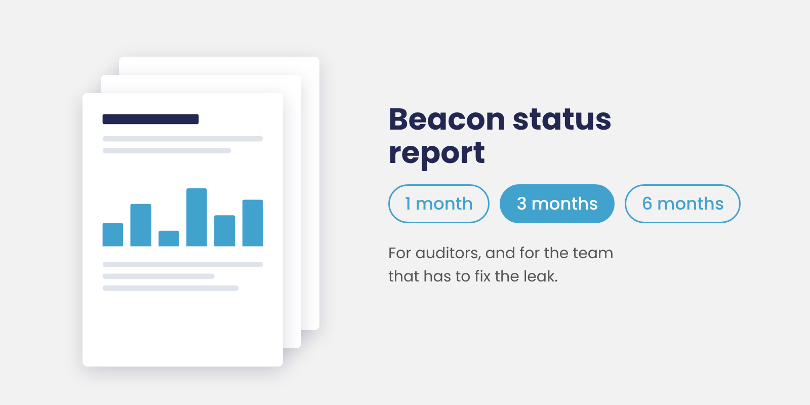
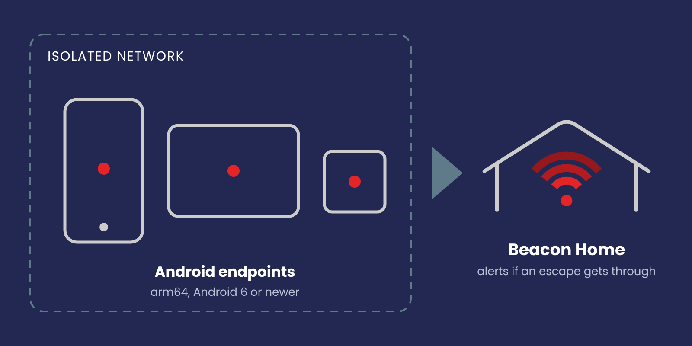
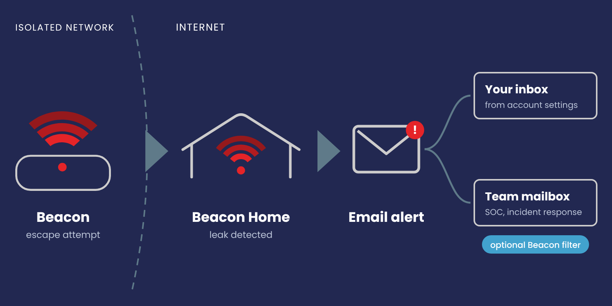

Beacon 5 is the biggest Beacon update in a while, and it will keep growing. Version 5.0 delivers the first set of new features and makes the changes under the hood that the next ones depend on, most notably Beacon Receiver.

Here's what's in Beacon 5.0 today, and what's coming in the following 5.x releases.

## Status reports for audits and internal communication
Customers often ask what they can hand to their auditors to show that Beacon is doing its job. Screenshots of Home get the point across, but they don't make a great audit document.

With Beacon 5 you can print a status report covering the past one, three or six months directly from the Overview in Home. The report uses the filters you have selected, so you can produce it for your whole environment or only for the Beacons that are in scope for a specific audit.

{: style="max-width: 640px; margin: 2rem auto;"}

The same report works inside your own organization too. When a leak needs fixing, the people who can fix it are often in another team, and a clear report is much easier to act on than a forwarded alert or a screenshot.

## Android Endpoint Beacon
Smart devices and other IoT equipment are increasingly used in restricted and isolated environments, and many of them run on Android. If those devices are expected to stay off the Internet, that expectation should be tested like any other.

Beacon 5 adds an Android Endpoint Beacon for exactly this. It runs on arm64 devices with Android 6 or newer, and you set it up from the Beacons view in Home like any other Beacon.

{: style="max-width: 640px; margin: 2rem auto;"}

## Email alerts
As Beacon deployments have grown, customers have asked for more flexible alerting. With Beacon 5, Home can send leak alerts by email, and users configure them themselves.

Users can register their own address in their account settings. Team addresses, such as a SOC or incident response mailing list, can be added in Home settings, with optional Beacon filters if different teams should get alerts for different Beacons.

{: style="max-width: 640px; margin: 2rem auto;"}

Home sends an alert as soon as it receives a new escape. If the same escape keeps succeeding, a three week cooldown keeps it from filling your inbox. This works the same way as with webhook alerts.

For on-prem Home, the host needs a sendmail compatible mail client. The manual has instructions for setting this up with msmtp.

## Access management
As more enterprises adopt Beacon, we've been asked for more ways to fit Home into existing identity setups and more control over who can do what. Beacon 5 adds:

* **Multiple authentication providers:** Google, Microsoft, Okta and Home's internal authentication can be enabled at the same time, using your organization's own identity provider tenant. Each authentication method has its own user account.
* **Two factor authentication:** Users of Home's internal authentication can now enable 2FA. Users who sign in through an external identity provider keep using their provider's MFA.
* **Admin role (on-prem Home):** Admin users can manage teams and users across Home and invite new users. For organizations with teams in different locations and business units, Beacon access can now be managed centrally, without routing every change through one person.

## Licensing
On-prem Home now uses a license file. In practice not much changes today, but it gives us more room to match Beacon subscriptions to customer needs in the future.

Install the license file before upgrading your on-prem Home. The steps are in the Install and Upgrade section of the [manual](https://portal.sensorfu.com/manual/home/application.html).

## Coming next in Beacon 5
* **Beacon Receiver:** Today Beacon tests whether an isolated network can reach Home. Beacon Receiver enables horizontal testing, so you can also test isolation between network segments inside your own environment.
* **More ways to run Beacon on endpoints**
* **New escape techniques**

We'll cover each of these in more detail when they ship.

## Onwards
Beacon 5 is the start of a new chapter for Beacon. A lot is changing around it, but the core idea stays where it has always been: always know if your network leaks.

The full list of changes is in the [changelog](https://portal.sensorfu.com/manual/CHANGELOG.html).

**\- Sebastian**

*Generated with AI assistance and finalized by human editors to ensure accuracy and quality.*
